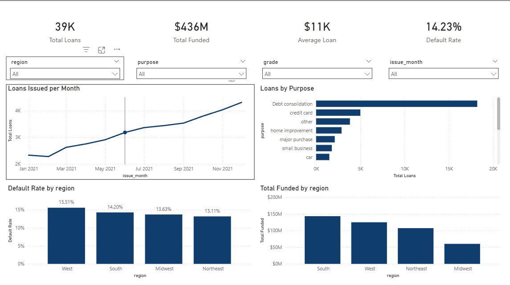
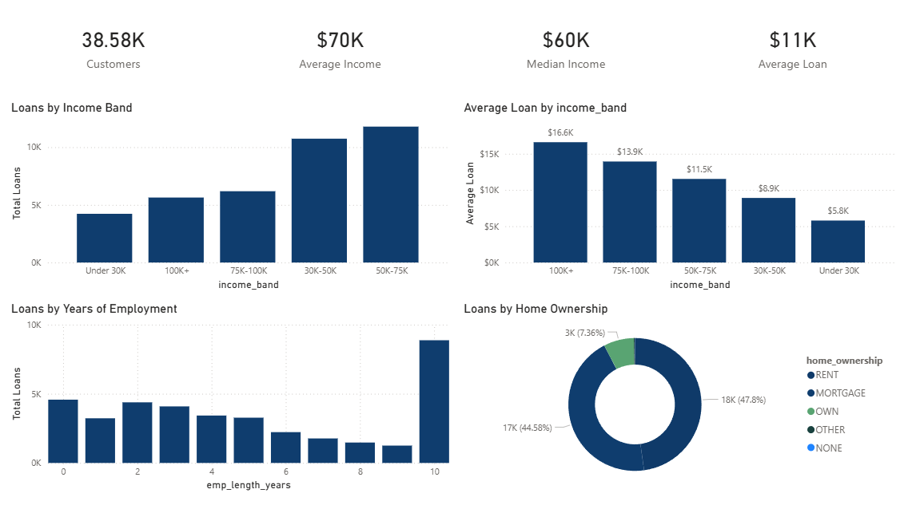
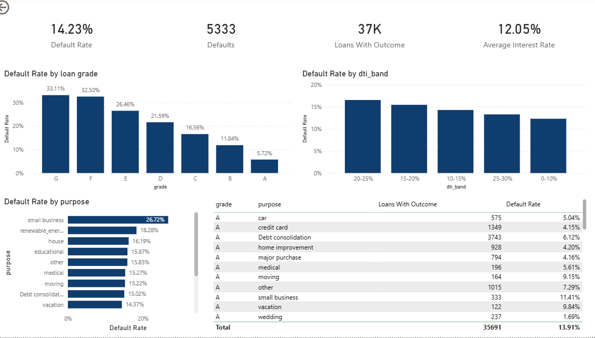

# Customer Credit & Loan Analytics Dashboard

An end-to-end data analyst project: raw loan data → Python cleaning → SQL analysis → interactive Power BI dashboard → business insights.

## Business objective
Understand loan volume, borrower segments, and observed default patterns for a loan portfolio, and identify which segments deserve a closer look.

## Dataset
- **Source:** Kaggle "Financial Loan Dataset" (public data, (https://www.kaggle.com/datasets/datawitharyan/financial-loan-dataset)), 38,576 loans issued in 2021, 24 columns.
- **Limitations of the data:** it contains only issued loans, so there is no approval/rejection field, no age, and no numeric credit score. Loan **grade (A to G)** is used as the risk indicator. Debt-to-income (DTI) ranges from 0% to 30%.

## Tech stack
Python (Pandas, Matplotlib, Seaborn) · SQL (SQLite) · Power BI + DAX · VS Code

## Project structure
```
data/raw/            original Excel file
data/processed/      cleaned CSV + SQLite database
notebooks/           01_eda.ipynb, 02_sql_analysis.ipynb
src/data_cleaning.py reusable cleaning script
sql/                 analysis_queries.sql
powerbi/             loan_analytics.pbix
reports/figures/     charts and dashboard screenshots
```

## Data cleaning methodology
- No duplicate loan IDs; the only missing values were in `emp_title` (1,438 rows), which is not used in analysis.
- Dropped `application_type` (every row is "INDIVIDUAL").
- Converted `term` ("36 months") and `emp_length` ("10+ years") to numbers; converted DTI and interest rate from fractions to percentages.
- Created: month, loan-to-income ratio, income bands, DTI bands, and a region column (50 states grouped into 4 regions).
- Annual income ranges from $4,000 to $6,000,000. The top 1% of incomes are **flagged** (`income_outlier`), not deleted.
- **Default flag:** 1 = Charged Off, 0 = Fully Paid. The 1,098 "Current" loans have no known outcome and are **excluded** from default-rate denominators.

## KPI definitions
| KPI | Definition |
|---|---|
| Total Loans | Count of loans |
| Total Funded | Sum of loan amount |
| Average Loan | Total funded ÷ number of loans |
| Default Rate | Charged Off ÷ (Charged Off + Fully Paid) |

## Dashboard
**Executive Overview**


**Customer Analytics**


**Risk & Portfolio**


## Key insights
1. **Volume nearly doubled over 2021.** Loans issued rose from 2,332 in January to 4,314 in December (+85%), and monthly funded amount rose from $25.0M to $54.0M.
2. **Overall observed default rate is 14.23%** (5,333 charged off out of 37,478 loans with a known outcome).
3. **Default rates rise steadily with grade:** 5.7% for grade A up to 33.1% for grade G.
4. **60-month loans defaulted far more often than 36-month loans:** 25.0% vs 10.7%. 60-month loans also carry higher interest (about 14.8% vs 11.0% on average).
5. **Small business loans stand out at 26.7%**, against 9.5% for weddings. Debt consolidation is the largest purpose (47% of loans) with a 15.0% default rate.
6. **Highest-risk segments** (100+ loans): grade F debt consolidation (35.5%, 547 loans) and grade E small business (34.8%, 184 loans).
7. **DTI shows a mild upward pattern:** 12.3% default in the 0-10% band to 16.5% in the 20-25% band. The 25-30% band (only 646 loans) is lower at 13.3%.
8. **Income-verified loans had a higher observed default rate (16.5%) than unverified loans (12.4%).** This is an association only; the data does not explain why.
9. **Regionally,** the South funded the most ($143.3M) while the West had the highest default rate (15.5%) and the Northeast the lowest (13.1%). California alone accounted for about 18% of funded amount.

*These are observed patterns, not causal claims.*

## What the business should investigate next
- Why small business loans default so often, and whether pricing or underwriting for them should change.
- Whether 60-month loans are priced high enough to cover their much higher default rate.
- Why verified-income borrowers show higher default rates (for example, are riskier applicants verified more often?).
- Pricing and approval for grades E to G, which hold a large share of high-risk loans.
- Why the West region has the highest default rate.

## Limitations
- One year of loans (2021); no long-term trend or seasonality analysis is possible.
- Only issued loans: no information on rejected applications, so approval rate cannot be measured.
- No credit score or age; grade is used as a proxy for risk.
- Observed associations only; no modelling or causal inference.

## How to reproduce
1. Install requirements: `pip install -r requirements.txt`
2. Download `financial_loan.xlsx` from Kaggle (Financial Loan Dataset, by datawitharyan) and place it in `data/raw/`. The raw file is not included in this repo.
3. Run `python src/data_cleaning.py`
4. Run the notebooks in `notebooks/` for EDA and SQL analysis
5. Open `powerbi/loan_analytics.pbix` in Power BI Desktop